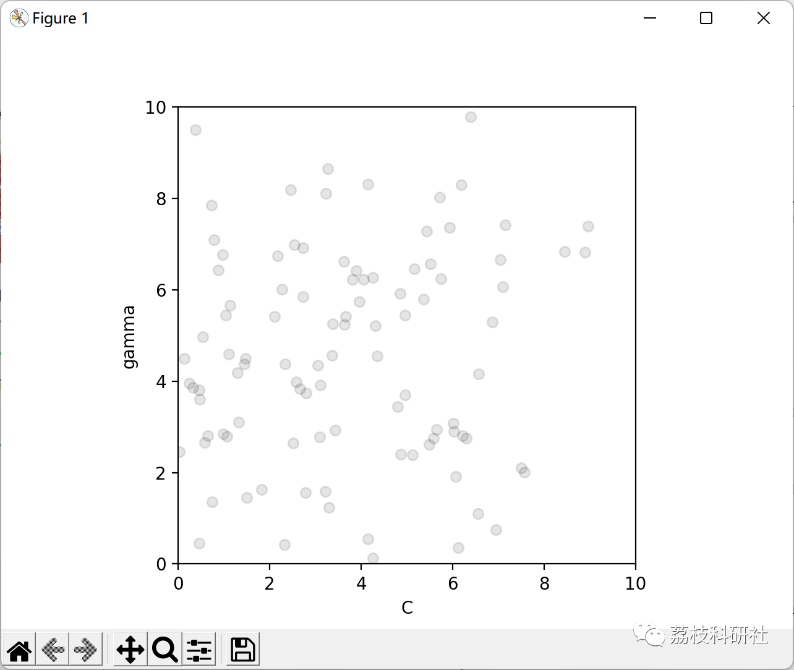
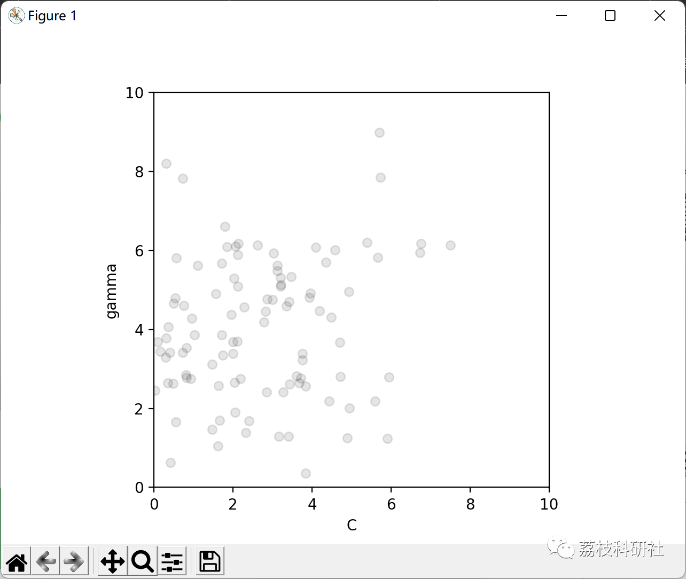
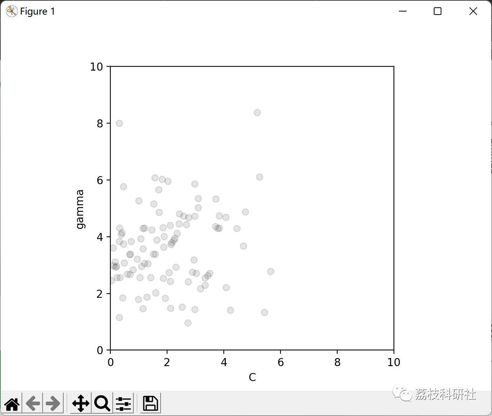
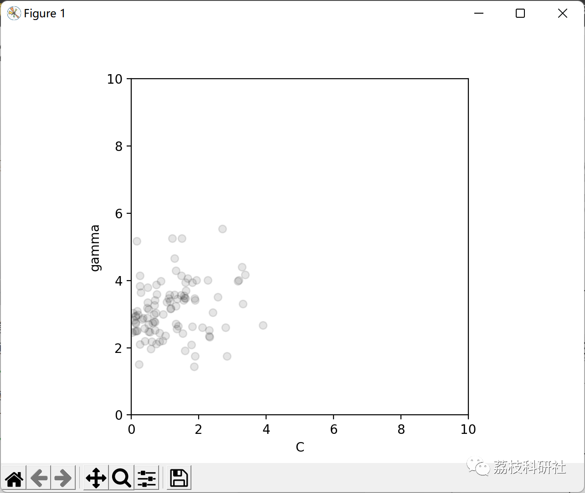
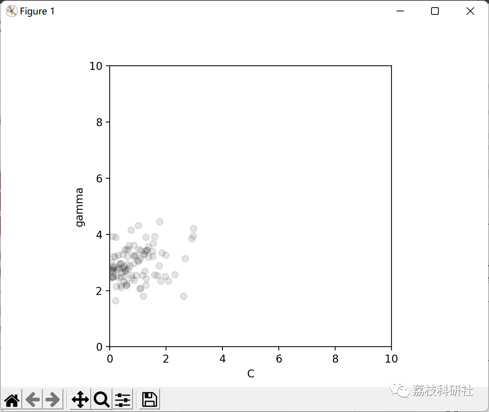

# Research on Support Vector Machine Optimization Based on Particle Swarm Algorithm (Python Code Implementation)

💥💥💞💞 Welcome to this blog❤️❤️💥💥
🏆 Bloggers' Advantages: 🌞🌞🌞 The content of the blog strives for rigorous thinking and clear logic to facilitate readers.
⛳️ Mantra: A journey of a thousand miles begins with a single step.
Litchi Research Society
Code Collection: Power Systems, Intelligent Algorithms and Applications, Neural Network Prediction, Path Planning, Optimized Scheduling, Workshop Scheduling, Image Processing, Signal Processing...
🎁 Special Section Link: ​
🌈🌈🌈🌟🌟🌟 Electrical Code Drone and Physical Applications Path Planning Intelligent Algorithms and Their Applications Optimized Scheduling Neural Network Prediction Workshop Scheduling Image Processing Romantic Her Signal Processing Mathematical Modeling My Thoughts Voice Processing Complete Code Issues
Directory
💥1 Overview
📚2 Running Results
🎉3 References
👨‍💻4 Python Code Implementation
💥1 Overview
This paper combines hierarchical clustering with binary trees, reducing error accumulation at each node by using hierarchical clustering. It employs the Particle Swarm Optimization algorithm to find the optimal category division, encoding categories into variables, and grouping samples that belong to the same fault type into the same cluster center. The Particle Swarm Optimization algorithm [1(particle swarm ptimization,PSO), initialized as a group of random particles. That is, a random initial solution, then particles adjust their flight trajectory based on their own flying experience and the flying experience of the group, referencing the position of the best particle in the solution space to search, and finding the optimal solution through iteration. The Genetic Particle Swarm Optimization algorithm integrates genetic algorithms and Particle Swarm Optimization algorithms, ensuring the strong global search capability of the genetic algorithm while also integrating the idea of particle position transition from the Particle Swarm Optimization algorithm [11], making its optimization process more efficient and obtaining higher precision solutions.
📚2 Running Results
🎉3 References
[1] He Xiao Er. Ship structure optimization based on Particle Swarm Optimization and Support Vector Machine [D]. Shanghai Jiao Tong University, 2014.
[1] Yu Zitang. Research on Support Vector Machines for Automotive Fault Diagnosis Based on Particle Swarm Optimization [J]. Computer Application Research, 2012, 29(02):572-574.
👨‍💻4 Python code implementation
Click the "Read More" button at the bottom left of the article.

## Images

<!-- PAYMENT_BLOCK -->

## Get this dataset

- Payment link (Stripe): [Buy now](https://buy.stripe.com/3cs8yP7sY87d0vu9AB)
- Payment QR code: 

<!-- /PAYMENT_BLOCK -->
